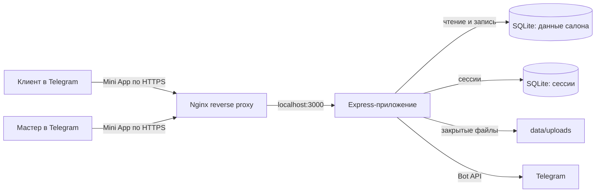

# Архитектура

## Схема приложения

Браузер получает статические файлы от Express. JSON API доступен по маршрутам `/api`. Nginx принимает HTTPS-запросы и передаёт их приложению. Для входа сервер проверяет подпись `initData` от Telegram и создаёт сессию. Значения `initDataUnsafe` со стороны браузера не считаются подтверждением личности.

## Структура кода

| Путь | Назначение |
| --- | --- |
| `src/server.js` | HTTP-маршруты, проверка Telegram-сессии, создание и изменение записей, уведомления, доступ к фотографиям. |
| `src/storage.js` | Миграции SQLite и транзакционная работа с данными. |
| `src/schedule.js` | Расчёт доступности и свободных слотов на 14 дней. |
| `src/telegram.js` | Проверка Telegram `initData`, запросы к Bot API, long polling и настройка кнопки бота. |
| `src/session-store.js` | Хранение Express-сессий в SQLite. |
| `src/config.js` | Чтение переменных окружения и начальной конфигурации. |
| `public/` | Интерфейс Telegram Mini App и статические файлы. |
| `deploy/install-ubuntu.sh` | Первичная настройка Ubuntu-сервера. |

## Идентификация и роли

Сервер проверяет Telegram ID по подписанным данным Mini App. Активные мастера хранятся в таблице `masters` и связаны с Telegram ID. При первичном заполнении пустой базы главным становится первый мастер из конфигурации. Новые мастера добавляются через заявку, которую подтверждает главный мастер.

Главный мастер может отключить другого мастера только после того, как его будущие активные записи перенесены или отменены. Перенос и отмена выполняются явно; запись сохраняется в истории. Отключённый мастер не показывается клиентам для новых записей.

## Записи и согласованность расписания

Свободные слоты рассчитываются по ежедневному графику мастера, исключениям для отдельных дат и времени, длительности услуги и шагу расписания. Каждая новая запись проверяется на пересечение с другими активными записями внутри транзакции SQLite. Слот могут занять после показа клиенту; в таком случае сервер сообщит о конфликте и предложит выбрать другое время.

Изменение рабочих часов или добавление нерабочего периода не меняет уже созданные записи. API возвращает список затронутых записей, чтобы мастер увидел предупреждение и принял решение. Перенос проверяет новый свободный слот и сохраняет изменение до отправки уведомления в Telegram. Если уведомление не доставлено, перенос остаётся, а интерфейс предлагает связаться с клиентом другим способом.

## Хранение данных

`data/bookings.sqlite3` содержит мастеров, записи и календарные исключения. `data/sessions.sqlite3` хранит веб-сессии. Фотографии клиентов находятся в `data/uploads/` и выдаются через закрытый маршрут, доступный только мастеру записи. Эти файлы — состояние конкретной установки, их нельзя добавлять в Git.

Миграции схемы выполняются при запуске через `BookingStorage`. Перед развёртыванием новой версии сохрани резервную копию папки `data/`.

## Границы доверия

- В Telegram Mini App используется HTTPS.
- Подпись данных входа проверяется на сервере с помощью токена бота.
- Изменяющие запросы проверяются по источнику, если заголовок `Origin` присутствует.
- Cookie сессии закрыта от JavaScript, требует HTTPS и использует `SameSite=None` для Telegram WebView.
- Права мастера и главного мастера проверяются по серверной сессии и базе данных.
- Фотографии клиентов не находятся в публичной папке статических файлов.
- Разрешено до трёх изображений JPEG, PNG или WebP размером до 5 МиБ каждое.

Операционные процедуры и резервное копирование описаны в [руководстве эксплуатации](OPERATIONS.md).
