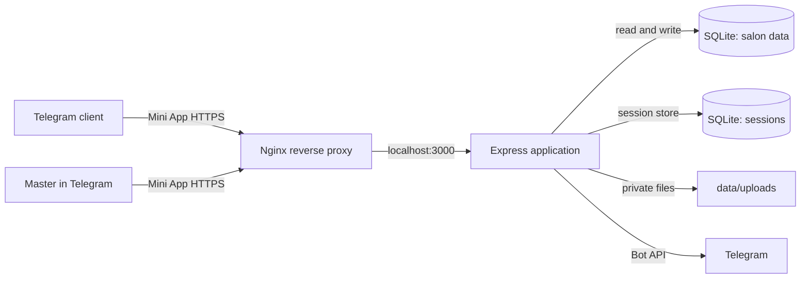

# Architecture

## Runtime shape

The browser receives static files from Express. The same server exposes JSON endpoints under `/api`; Nginx terminates HTTPS and forwards requests to the application. The app uses Telegram's signed `initData` to establish a server session. The browser's `initDataUnsafe` values are not treated as authentication.

## Code map

| Path | Responsibility |
| --- | --- |
| `src/server.js` | HTTP routes, Telegram session authentication, booking coordination, notifications, photo access. |
| `src/storage.js` | SQLite schema migration and transactional persistence. |
| `src/schedule.js` | 14-day availability and free-slot calculation. |
| `src/telegram.js` | Telegram `initData` verification, Bot API requests, long polling, menu-button setup. |
| `src/session-store.js` | Persistent Express sessions backed by SQLite. |
| `src/config.js` | Environment and bootstrap configuration parsing. |
| `public/` | Telegram Mini App interface and static assets. |
| `deploy/install-ubuntu.sh` | Initial Ubuntu server provisioning. |

## Identity and roles

Telegram user IDs are verified from signed Mini App data. Active master records are stored in the `masters` table and linked to those IDs. The first configured master is marked as the main master only when an empty database is initially seeded. New masters are added through access requests approved by the main master.

The main master can deactivate another master only after there are no future active appointments. The transfer/cancel operation is explicit and preserves an appointment record. Deactivation hides the master from new clients; historical records remain available to the main master.

## Booking and availability consistency

Slots are generated from each master's daily working interval, one-off availability blocks, the configured service duration, and the configured slot step. Every booking write checks for overlapping active appointments inside a SQLite transaction. A slot displayed as free can still be taken by another client before submission; the server then returns a conflict and the client must choose again.

Changing working hours or adding an availability block does not modify appointments already on the calendar. The API returns any affected appointments so the master can see a warning and decide what to do. Rescheduling validates a new free slot and updates the appointment before sending a Telegram notification. A failed notification does not roll back the move; the interface tells the master to contact the client by another method.

## Persistence

`data/bookings.sqlite3` stores salon entities, appointments, and one-off availability blocks. `data/sessions.sqlite3` stores web sessions. Client photos live in `data/uploads/` and are served through an authenticated route scoped to the assigned master. These files are deployment state and must not be tracked by Git.

Database schema changes are applied by `BookingStorage` during startup. Take a backup of `data/` before deploying a new release.

## Trust boundaries

- The Mini App is served only through HTTPS in a Telegram deployment.
- Telegram login data is validated with the bot token on the server.
- Mutating requests are checked against the request origin when one is present.
- Session cookies are HTTP-only, secure, and `SameSite=None` for Telegram WebViews.
- Master and main-master endpoints resolve permissions from the server session and database.
- Customer photo files are not placed in the public static directory.
- Uploads are limited to three JPEG, PNG, or WebP images, each up to 5 MiB.

For operational controls and backup instructions, see [OPERATIONS.md](OPERATIONS.md).
